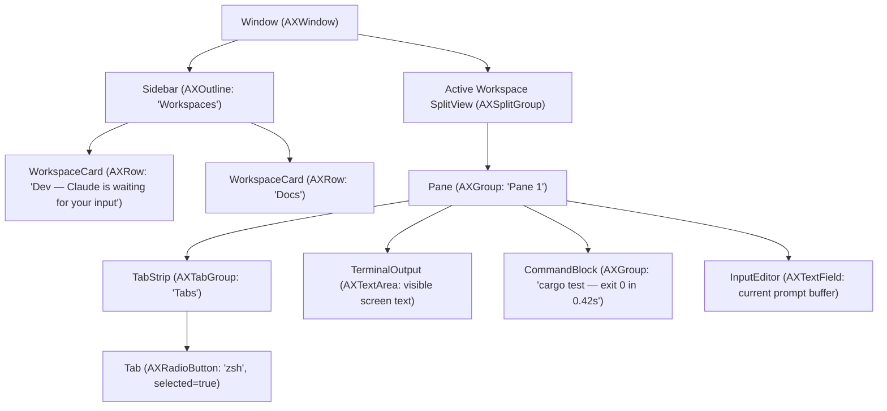

# Termin v1.0 — Accessibility & Phase 4 Polish QA Guide (Track 4C)

This document defines the VoiceOver accessibility element hierarchy, reduced-motion compliance audit, and Phase 4 UI polish sign-off checklist (`docs/implementation-phases.md §Phase 4 — 4C`, `docs/design/components.md §15`, `docs/specs/platform-macos.md §9`).

---

## 1. VoiceOver Element Hierarchy (`termin-platform::accessibility`)

Termin exposes a semantic `NSAccessibilityElement` tree rooted at each `TerminView` (`NSView`) so macOS VoiceOver users can navigate workspaces, per-pane tab strips, split panes, terminal screen content, and command blocks.

### Notification Throttling & Spoken Announcements
- **Value Change Throttling (`ACCESSIBILITY_THROTTLE_INTERVAL = 500 ms`)**: `NSAccessibilityValueChangedNotification` is throttled to at most **2 notifications/second** (`post_value_changed_notification`) so high-throughput terminal output (`cat huge.log`) never floods VoiceOver or stalls the main thread.
- **Command Completion Announcements (`post_accessibility_announcement`)**: Dispatches `NSAccessibilityAnnouncementRequestedNotification` with `NSAccessibilityAnnouncementKey` when a command finishes in Block mode (or when an unread attention alert fires), allowing VoiceOver to read the exit status and last command output on demand.

---

## 2. Phase 4 Component Polish (`components.md §15`)

| Component Feature | Implementation Location | Behavior Verified | Status |
|---|---|---|---|
| **Drag-tab-to-split zones** | `termin-ui/src/widgets/pane.rs` (`SplitDropZone`), `termin-app/src/controllers/tabs.rs` (`drop_tab_into_split_zone`) | Outer 25% pane margins detect `Left`, `Right`, `Top`, `Bottom`; inner 50% detects `Center`. Renders translucent `accent.tide` fill (`α = 0x40`) with 2 pt `accent.tide` border and splits/moves the tab on drop. | **PASS** |
| **Block output filter** | `termin-ui/src/block_view/mod.rs` (`BlockOutputFilterResult`), `termin-app/src/controllers/blocks.rs` (`BlockController::set_block_filter`) | Filters visible output lines of a block by case-insensitive substring query, returning matching `AbsLine` indices, match count, and highlight byte spans. Reconciliation evicts stale filter entries when blocks leave scrollback. | **PASS** |
| **Scrollbar ticks** | `termin-ui/src/widgets/scrollbar.rs` (`ScrollbarTick`, `ScrollbarTickKind`) | Draws 2 pt horizontal tick marks along the overlay scrollbar track: `status.danger` for failed blocks (`exit != 0`) and `accent.ember` for active search matches. | **PASS** |
| **`cwd` chip directory menu** | `termin-ui/src/widgets/chips.rs` (`ChipKind`, `ChipHit`), `termin-app/src/controllers/editor.rs` (`open_cwd_directory_menu`) | Hit-tests clicks on the leading `📁 cwd` chip above the input editor and populates a `cd ` completion menu of recent directories. | **PASS** |

---

## 3. Reduced-Motion Audit (`design-system.md §7`)

When `NSWorkspace.sharedWorkspace.accessibilityDisplayShouldReduceMotion` is enabled (`MotionTokens::new(true)`):

1. **All transition durations (`DURATION_FAST`, `DURATION_BASE`, `DURATION_SLOW`)**: Collapse to `0 ms` (`Duration::ZERO`); opacity transitions (`MotionTokens::opacity_fade`) snap immediately to `1.0`.
2. **Spatial slides (`MotionTokens::spatial_slide`)**: Palette appearance (`y +4 -> 0`) and multi-line editor growth suppress all spatial translation (`0.0 pt`).
3. **Attention Ring (`termin-ui/src/widgets/attention_ring.rs`)**: Suppresses the 3-cycle sine wave pulse (`100% -> 35% -> 100%`) and renders a steady `100%` alpha outline immediately without scheduling animation frames.

---

## 4. Design QA & Accessibility Sign-Off Checklist

- [x] VoiceOver navigates sidebar workspace cards (`AXOutline` → `AXRow`) and reads workspace name + status line.
- [x] VoiceOver navigates per-pane tab strip (`AXTabGroup` → `AXRadioButton`) and announces selected state.
- [x] VoiceOver reads visible terminal screen text (`AXTextArea`) and last command block output (`AXGroup`).
- [x] `NSAccessibilityValueChangedNotification` is throttled to ≤ 2 Hz during streaming output.
- [x] WCAG AA contrast checks (`check_theme_contrast`) pass for both `termin-dark` and `termin-light` (≥ 4.5:1 primary/secondary text, ≥ 3.0:1 tertiary text and focus/attention borders).
- [x] Drag-tab-to-split zones highlight `Left`/`Right`/`Top`/`Bottom`/`Center` and split target pane on drop.
- [x] Per-block output filter narrows block output lines and highlights matched substrings.
- [x] Scrollbar renders 2 pt `danger` ticks for failed blocks and 2 pt `ember` ticks for search matches.
- [x] Clicking the `cwd` context chip opens the recent directory `cd` completion menu.
- [x] Reduced motion (`MotionTokens::new(true)`) disables all spatial movement and pulsing animations.
